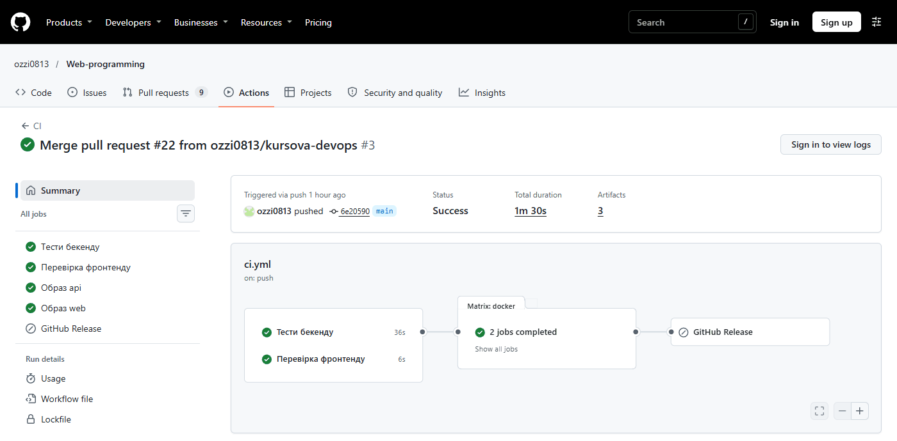
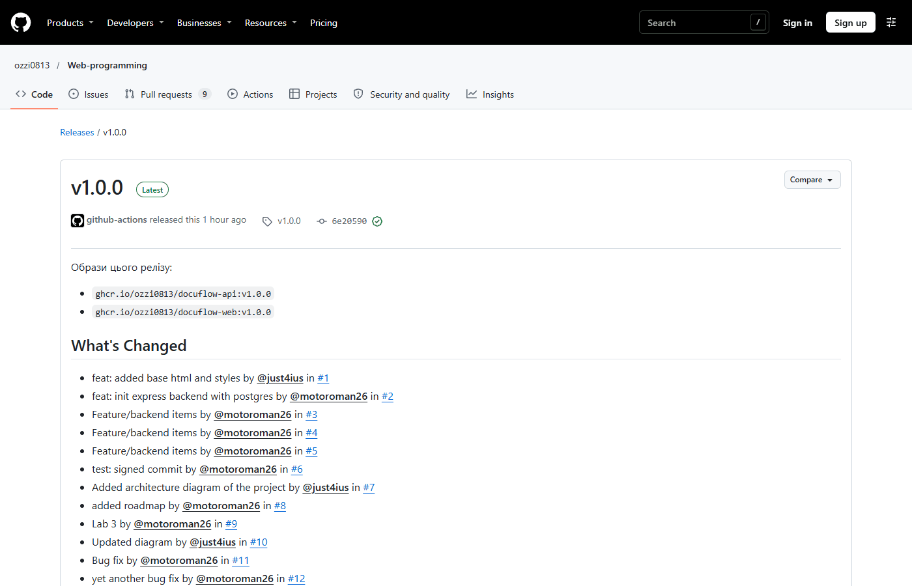

# Лабораторна робота №7: CI/CD на GitHub Actions

**Мета:** налаштувати CI (тести, перевірка коду, збірка) і delivery контейнерних образів для всіх сервісів проєкту DocuFlow.

Рівень: **90–100 балів** — CI + delivery для всіх сервісів (`api`, `web`) у власному репозиторії, ≥ 2 style points.

---

## 1. Файли

| Файл | Призначення |
|---|---|
| [`.github/workflows/ci.yml`](../../.github/workflows/ci.yml) | Увесь pipeline: test → lint → docker (matrix api/web) → release |
| [`.github/dependabot.yml`](../../.github/dependabot.yml) | Оновлення залежностей npm, GitHub Actions, Docker |
| [`backend/Dockerfile`](../../backend/Dockerfile), [`web/Dockerfile`](../../web/Dockerfile) | Образи сервісів |

## 2. Як працює pipeline

```
push / pull_request
   │
   ├─ test   (PostgreSQL 15 як service-контейнер)
   │     npm ci (з кешем) → npm run migrate → node --test (spec + junit + lcov)
   │     → артефакт test-reports, підсумок у Job Summary
   ├─ lint   node --check для всіх файлів web/*.js, web/js/*.js
   │
   └─ docker (needs: test, lint; matrix: api, web)
         buildx + кеш GHA → теги sha-<commit> / vX.Y.Z / X.Y / latest
         PR: лише збірка · main і теги v*: публікація в GHCR
         Trivy scan (exit-code 0 — лише звіт)
            │
            └─ release (лише для тегів v*) — GitHub Release з авто-нотатками
```

- **Тригери:** `push` у `main`, теги `v*.*.*`, `pull_request` у `main`, ручний `workflow_dispatch`.
- **Кеш:** `actions/setup-node` з `cache: npm` (за `backend/package-lock.json`) і кеш шарів Docker `type=gha`.
- **Тести в CI:** 32 тести лаб 4–5, 34 юніт-тести курсового проєкту і 6 інтеграційних тестів API зі справжньою PostgreSQL (`RUN_DB_TESTS=1`).
- **Обмеження часу:** `timeout-minutes` для кожного job.

## 3. Delivery (варіант A — GHCR)

| Сервіс | Образ |
|---|---|
| API | `ghcr.io/ozzi0813/docuflow-api` |
| Web | `ghcr.io/ozzi0813/docuflow-web` |

Теги образів: `sha-<7 символів коміту>` завжди; для релізу `v1.0.0` — ще `v1.0.0` і `1.0`; для `main` — `latest`.

Випуск релізу:
```bash
git tag v1.0.0
git push origin v1.0.0
```

## 4. Style points (виконано 6)

1. **Семантичне тегування** `vX.Y.Z` + `sha-<commit>` (`docker/metadata-action`).
2. **Посилений контроль дозволів і concurrency:** `permissions: contents: read` за замовчуванням, `packages: write` лише для job `docker`, `contents: write` лише для `release`; `concurrency` з `cancel-in-progress: true`.
3. **Job Summary:** кількість тестів, помилок і покриття рядків; список опублікованих тегів образів.
4. **Dependabot** для npm, GitHub Actions і Docker.
5. **Trivy security scan** з `exit-code: 0` (звіт без зупинки виконання).
6. **Автоматичні реліз-нотатки** на тег `v*` (`softprops/action-gh-release`, `generate_release_notes: true`).

## 5. Результати

- Успішний запуск на `main` після злиття PR #22: https://github.com/ozzi0813/Web-programming/actions/runs/43852349064. Тести бекенду (36 с) і перевірка фронтенду (6 с), потім матриця збірки образів `api`/`web` з Trivy. Артефакти: `test-reports` (JUnit + покриття) та два `.dockerbuild`.
- Реліз за тегом `v1.0.0`: https://github.com/ozzi0813/Web-programming/actions/runs/43853066143 → https://github.com/ozzi0813/Web-programming/releases/tag/v1.0.0 (образи `ghcr.io/ozzi0813/docuflow-api:v1.0.0`, `ghcr.io/ozzi0813/docuflow-web:v1.0.0`, автоматичні release notes).
- Пакети: https://github.com/ozzi0813?tab=packages
- Dependabot одразу після злиття відкрив 9 PR з оновленнями (npm, GitHub Actions, Docker), і CI на кожному з них зелений.
- **Перший запуск PR впав** на кроці `Set up job`: `Unable to resolve action aquasecurity/trivy-action@0.28.0`, бо автори прибрали стару версію. Версію оновили до `0.35.0`, і повторний запуск зелений. Це живий приклад, навіщо фіксувати версії та тримати Dependabot.





## 6. Контрольні питання

**Як заборонити злиття без зеленого CI?** Settings → Branches → Branch protection rule для `main` → «Require status checks to pass» → вибрати `Тести бекенду` і `Перевірка фронтенду`.

**Чому образи не публікуються з pull request?** PR можуть надходити з форків. Давати їм `packages: write` небезпечно, тому в PR образ лише збирається (перевірка Dockerfile).

**Чому локально тести проходять, а в CI можуть ні?** Інше оточення: версія Node, відсутність `.env`, чиста БД. Тому в CI фіксуємо Node 22, використовуємо `npm ci` (точні версії з lock-файлу) і запускаємо міграції на чистій PostgreSQL.
