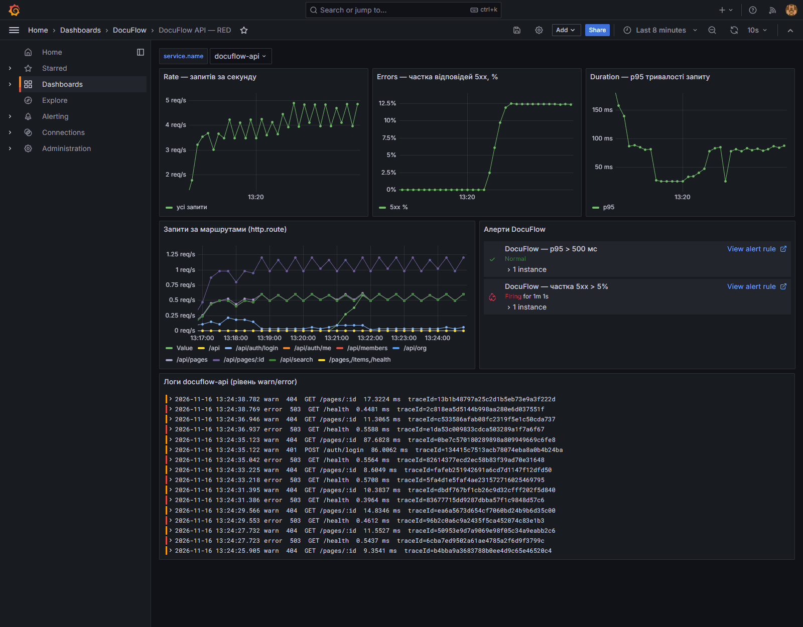
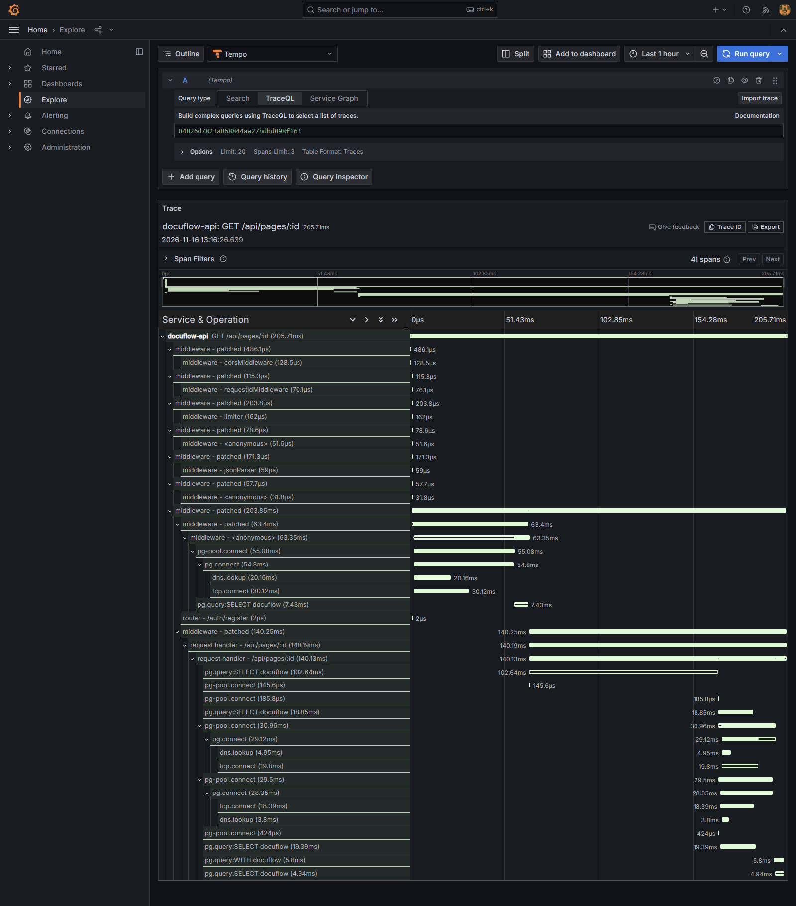
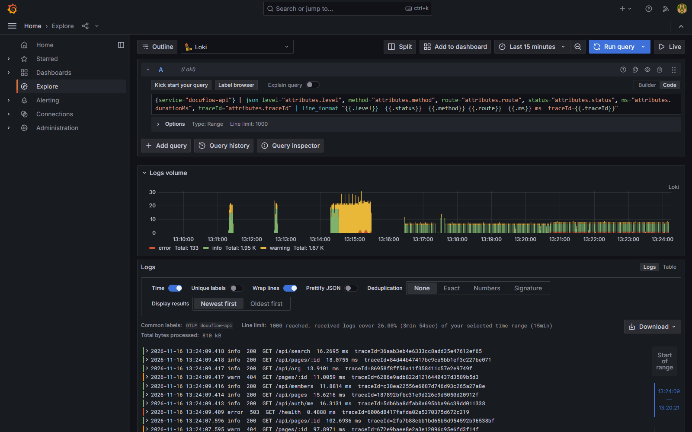
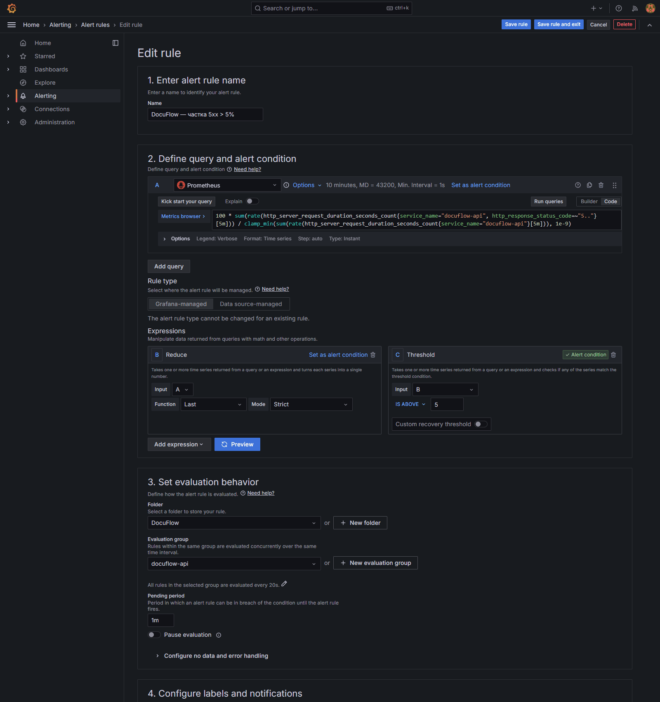
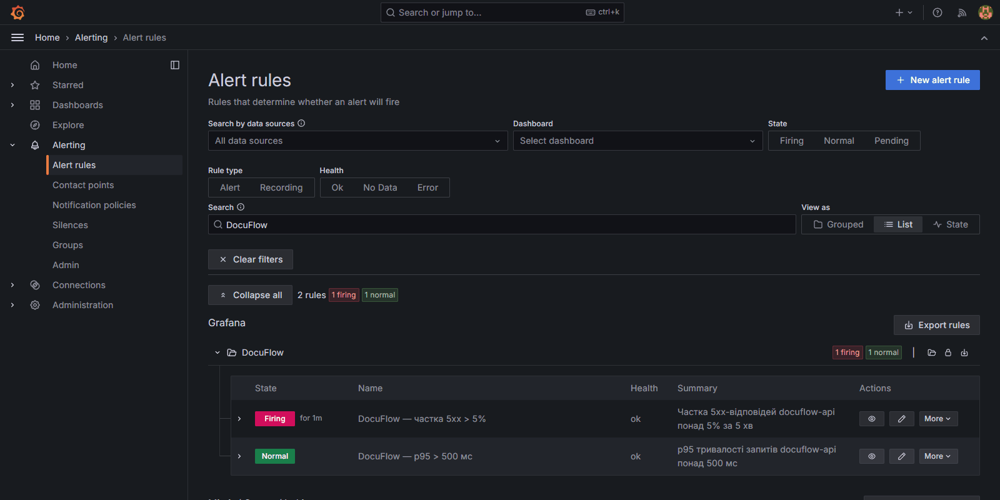
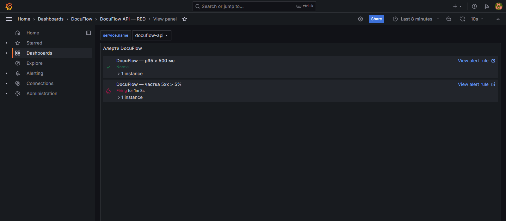

# Лабораторна робота №8: Observability (Grafana, Loki, Tempo, OpenTelemetry)

**Мета:** підключити бекенд DocuFlow до стенду observability-demo, побудувати RED-дашборд і налаштувати алерти.

Цільовий рівень: **95–100 балів**.

---

## 1. Що зроблено в коді

| Файл | Що робить |
|---|---|
| [`backend/tracing.js`](../../backend/tracing.js) | OpenTelemetry SDK: трейси та метрики HTTP, Express і `pg` → OTLP HTTP (`/v1/traces`, `/v1/metrics`). Вмикається лише якщо задано `OTEL_EXPORTER_OTLP_ENDPOINT`. |
| [`backend/api/middleware/requestLogger.js`](../../backend/api/middleware/requestLogger.js) | JSON-лог кожного запиту: `level`, `route`, `status`, `durationMs`, `requestId`, `traceId`, `userId`, `workspaceId`. Пише в stdout і у файл `LOG_FILE` (його читає Loki). |
| [`backend/api/middleware/auth.js`](../../backend/api/middleware/auth.js) | Додає до активного спану атрибути `enduser.id`, `enduser.role`, `docuflow.workspace_id`. |
| [`observability/docuflow-red-dashboard.json`](../../observability/docuflow-red-dashboard.json) | Дашборд Grafana «DocuFlow API — RED» (6 панелей). |
| [`observability/stand/`](../../observability/stand) | Доповнені конфіги стенду: колектор приймає OTLP-метрики й віддає їх Prometheus. |

**Бібліотеки:** `@opentelemetry/sdk-node`, `@opentelemetry/auto-instrumentations-node`, `@opentelemetry/exporter-trace-otlp-http`, `@opentelemetry/exporter-metrics-otlp-http`.

**Атрибути:**
- `service.name=docuflow-api`, `service.version`, `deployment.environment` — ресурс;
- `http.route`, `http.request.method`, `http.response.status_code` — автоматично;
- `enduser.id`, `enduser.role`, `docuflow.workspace_id` — наші.

## 2. Запуск (покроково)

```bash
# 1. Стенд викладача
git clone https://github.com/vivalafit/observability-demo
cd observability-demo
docker compose up -d --build
docker compose stop loadgen          # вимикаємо тестове навантаження

# 1а. Доповнити стенд (у ньому метрики збираються лише з /metrics demo-app):
#     скопіювати наші конфіги поверх і перезапустити колектор та Prometheus
cp <шлях-до>/Web-programming/observability/stand/otel-collector-config.yaml .
cp <шлях-до>/Web-programming/observability/stand/prometheus.yml .
docker compose restart collector prometheus

# 2. Наш бекенд з телеметрією (у другому терміналі, папка backend)
#    PowerShell:
$env:OTEL_EXPORTER_OTLP_ENDPOINT="http://localhost:4318"
$env:LOG_FILE="<шлях-до>/observability-demo/data/logs/docuflow-api.log"
npm run start:otel

# 3. Трафік: відкрити фронтенд і поклацати сторінки, або:
#    кілька разів «Запит з помилкою 503» на labs.html — для помилок 5xx
```

**Що довелося змінити під час запуску на стенді:**
- у колекторі стенду не було конвеєра метрик (Prometheus збирав лише `/metrics` demo-app). Ми додали конвеєр `otlp → prometheus` (порт 8889) і job `docuflow-otlp` у `prometheus.yml`, файли лежать у [`observability/stand/`](../../observability/stand). Завдяки `resource_to_telemetry_conversion` атрибут `service.name` стає лейблом `service_name="docuflow-api"`;
- у новій версії OpenTelemetry SDK параметр `metricReader` замінили на `metricReaders: [...]`. Старий параметр SDK мовчки ігнорував, тож метрики не відправлялися. Виправлено в `tracing.js`;
- колектор стенду бере час логу з поля `ts`, тому в `requestLogger` поле `time` перейменовано на `ts`;
- у Loki логи мають лейбли `service` та `exporter`, а сам рядок — це JSON `{"body": ..., "attributes": {...}}`. Тому запит логів у дашборді змінено на `{service="docuflow-api"} | json level="attributes.level" ...`.

Перевірені на стенді назви: метрика `http_server_request_duration_seconds_count|_bucket`, лейбли `service_name`, `http_route`, `http_request_method`, `http_response_status_code`.

## 3. RED-дашборд (75 балів)

Імпорт: Grafana → Dashboards → New → Import → завантажити `observability/docuflow-red-dashboard.json` → вибрати Prometheus і Loki.

| Панель | Запит |
|---|---|
| Rate | `sum(rate(http_server_request_duration_seconds_count{service_name="docuflow-api"}[5m]))` |
| Errors, % | `100 * sum(rate(..._count{service_name="docuflow-api", http_response_status_code=~"5.."}[5m])) / sum(rate(..._count{service_name="docuflow-api"}[5m]))` |
| Duration p95 | `histogram_quantile(0.95, sum by (le) (rate(http_server_request_duration_seconds_bucket{service_name="docuflow-api"}[5m])))` |
| За маршрутами | `sum by (http_route) (rate(..._count{service_name="docuflow-api"}[5m]))` |
| Логи warn/error | `{service="docuflow-api"} \| json level="attributes.level", route="attributes.route", status="attributes.status" \| level=~"warn\|error"` (LogQL) |
| Alert list | алерти з назвою, що містить «DocuFlow» |

Усі панелі використовують `$__rate_interval` і час дашборду, тож зміна періоду впливає на всі.

**Як цим користуватись у проді:** Rate показує навантаження. Errors — частку збоїв, саме вона сигналізує, що користувачі не можуть працювати. p95 показує, як довго чекають «майже всі» користувачі. Панель «За маршрутами» показує, який ендпоінт гальмує.

## 4. Трейси (90 балів)

У Grafana → Explore → Tempo → Search → Service Name = `docuflow-api`. Типовий трейс `GET /api/pages/:id` містить спани Express middleware, авторизації (`SELECT ... workspace_members`) та SQL-запитів сторінки, блоків, файлів і шляху.

**Приклади використання атрибутів:**
- атрибути `enduser.*` і `docuflow.workspace_id` ставляться на спан middleware авторизації (активний у момент перевірки токена);
- знайти всі повільні запити однієї компанії: TraceQL `{ span.docuflow.workspace_id = 1 } && { kind = server && duration > 200ms }`;
- усі запити ролі viewer: `{ span.enduser.role = "viewer" }`;
- перейти з рядка логу в Loki до трейсу за полем `traceId`.

## 5. Алерти (95–100 балів)

Grafana → Alerting → Alert rules → New alert rule (папка `DocuFlow`):

| Назва | Умова | Вікно | Що робити команді |
|---|---|---|---|
| **DocuFlow — частка 5xx > 5%** | `100 * sum(rate(..._count{service_name="docuflow-api",http_response_status_code=~"5.."}[5m])) / sum(rate(..._count{service_name="docuflow-api"}[5m])) > 5` | 5 хв | Перевірити `/ready` і логи `level=error`, доступність PostgreSQL, останній деплой (відкотити `kubectl rollout undo`). |
| **DocuFlow — p95 > 500 мс** | `histogram_quantile(0.95, sum by (le) (rate(..._bucket{service_name="docuflow-api"}[5m]))) > 0.5` | 5 хв | Знайти в Tempo найповільніші спани (зазвичай SQL), перевірити індекси та навантаження на БД, за потреби збільшити репліки. |

Обидва правила лежать у папці `DocuFlow`, група `docuflow-api` з інтервалом перевірки 20 с і pending period 1 хв. Лейбли: `team=docuflow` і `severity=critical|warning`. В анотаціях записано `summary` та `runbook`, тобто що робити черговому.

Contact point `docuflow-webhook` (тип webhook) надсилає POST на `http://host.docker.internal:5050/alerts`. На стенді там слухав маленький приймач, який записав у консоль:
```
2026-11-16T11:24:00Z firing DocuFlow — частка 5xx > 5%=firing
```
Notification policy: алерти з лейблом `team=docuflow` → `docuflow-webhook` (group_wait 10s, repeat 1h). У реальній команді замість приймача буде Slack/Telegram/email.

Як спровокувати: кілька разів поспіль натиснути «Запит з помилкою 503» на `labs.html` або запустити
```bash
for i in $(seq 1 50); do curl -s -H "X-Simulate-Error: 503" http://localhost:8080/health > /dev/null; done
```

## 6. Результати на стенді (16.11.2026)

Стенд `vivalafit/observability-demo` (Grafana 10.4, Prometheus 2.53, Loki 2.9, Tempo 2.4, OTel Collector 0.98) і DocuFlow API з `npm run start:otel`. Трафік: три демо-користувачі (owner/hr/staff) ~4 запити/с протягом 3 хв, потім ще 4 хв з додатковими запитами `X-Simulate-Error: 503`.

**1. RED-дашборд.** Rate ~4 req/s; Errors 0%, а під час хвилі 503 зростає до ~12%; p95 ~80–100 мс; розбивка за `http_route`; панель алертів; логи warn/error з `traceId`.



**2. Трейс у Tempo.** `GET /api/pages/:id` (205 мс, 41 спан): middleware Express → авторизація (SQL `workspace_members`) → підключення до пулу PostgreSQL → SQL сторінки (102 мс), блоків, файлів і рекурсивний `WITH` для шляху. Найдовша частина — перше підключення до БД (`pg.connect` + DNS + TCP), наступні запити його вже не мають.



**3. Логи в Loki.** `{service="docuflow-api"} | json ... | line_format`: рівень, статус, маршрут, тривалість і `traceId` для переходу до трейсу.



**4. Налаштування алерту.** Запит A (PromQL, частка 5xx за 5 хв) → Reduce (Last) → Threshold `IS ABOVE 5`, pending period 1m.



**5. Alerting.** Правило «частка 5xx» у стані **Firing**, p95 — Normal.



**6. Панель Alert list на дашборді.**


