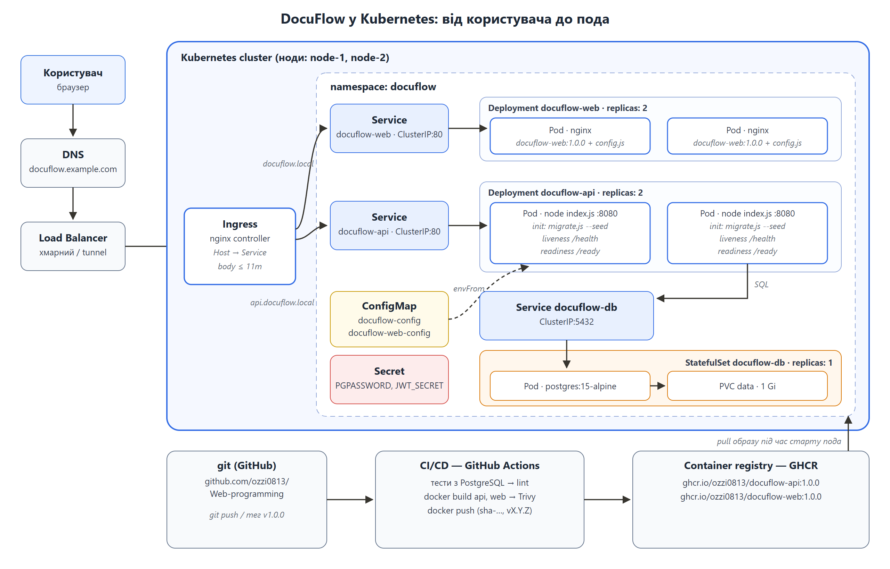

# Лабораторна робота №9: Теоретична схема Kubernetes-додатку

**Сервіс:** DocuFlow — корпоративна база знань (регламенти, статутні документи, посадові інструкції, оргструктура). Користувачі — працівники компаній: власник, адміністратор, редактори та глядачі. Вони працюють через браузер.

## Опис дизайну

- **Що моделюємо.** Два наші сервіси — `docuflow-web` (Nginx зі статичним фронтендом) і `docuflow-api` (Node.js/Express) — та базу PostgreSQL.
- **Namespace.** Усе живе в namespace `docuflow`. Окремий namespace можна створити для `stage`.
- **Шлях запиту ззовні.** Користувач відкриває `https://docuflow.example.com`. DNS повертає IP хмарного Load Balancer, далі йде **Ingress-контролер** (nginx). Він маршрутизує:
  - Host `docuflow.example.com` → Service `docuflow-web` (ClusterIP:80) → поди web;
  - Host `api.docuflow.example.com` → Service `docuflow-api` (ClusterIP:80) → поди api (порт 8080).
- **Скільки подів.** `docuflow-api` — 2–3 репліки: базова відмовостійкість і оновлення без простою (rolling update). `docuflow-web` — 2 репліки. PostgreSQL — StatefulSet з 1 репліки і постійним диском (PVC). Service розподіляє трафік між усіма готовими подами (readiness `/ready`).
- **git → CI/CD → registry.** Розробник пушить код у `github.com/ozzi0813/Web-programming`. GitHub Actions запускає тести, збирає Docker-образи й пушить їх у GitHub Container Registry (`ghcr.io/ozzi0813/docuflow-api:1.0.0`, `ghcr.io/ozzi0813/docuflow-web:1.0.0`). Deployment посилається на тег образу. Під час старту поди скачують образ з registry.

## Сутності на схемі

| Сутність | У DocuFlow |
|---|---|
| Cluster / Node | кластер з 2–3 нод; поди API розкидані по різних нодах |
| Namespace | `docuflow` |
| Deployment | `docuflow-api` (2 репліки, образ `docuflow-api:1.0.0`), `docuflow-web` (2 репліки) |
| StatefulSet | `docuflow-db` (PostgreSQL 15 + PVC 1 Gi) |
| Service | `docuflow-api`, `docuflow-web`, `docuflow-db` — усі ClusterIP |
| Ingress | `docuflow-ingress`, маршрутизація за Host |
| ConfigMap / Secret | налаштування API / пароль БД і `JWT_SECRET` |

Повний шлях запиту: **Client → DNS → Load Balancer → Ingress → Service → Pod**.

Практична реалізація цієї схеми в Minikube — у [лабораторній №10](lab_10.md) і папці [`k8s/`](../../k8s).
