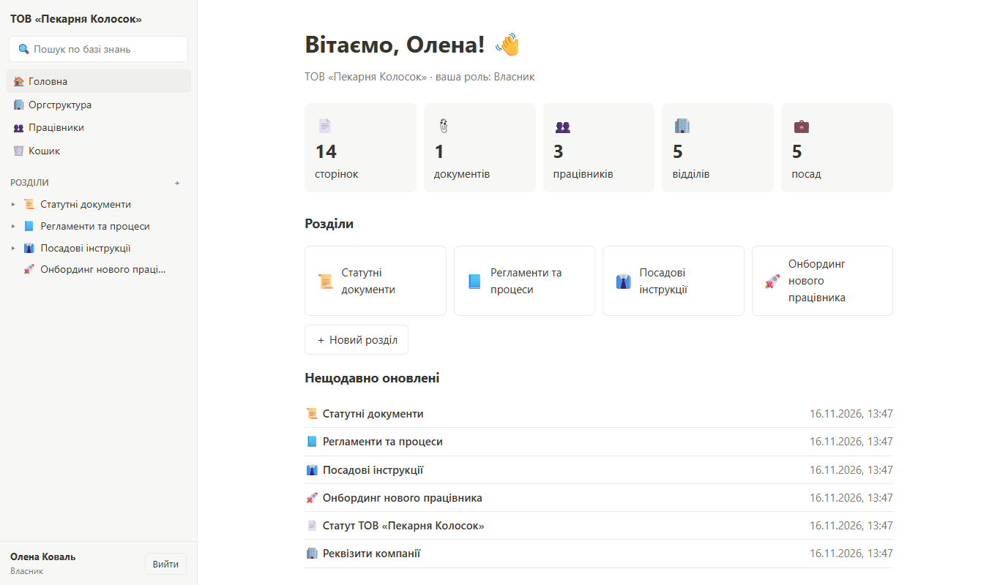

# Лабораторна робота №10: Kubernetes, практична частина (REPORT)

Рівні 60–90 виконано у форку навчального репозиторію [`vivalafit/k8s-demo`](https://github.com/vivalafit/k8s-demo), звіт із виводами — у `LAB10_REPORT.md` цього форку (посилання: **<вставити посилання на форк>**). Тут описано **рівень 100**: міграцію власного проєкту DocuFlow у Kubernetes, а також відповіді на контрольні запитання.

---

## 1. Власний сервіс

DocuFlow — корпоративна база знань. Ендпоінти для перевірки: `GET /health` (liveness), `GET /ready` (readiness, перевіряє PostgreSQL), `GET /api/...` (API курсового проєкту). Репозиторій: https://github.com/ozzi0813/Web-programming

Маніфести — у папці [`k8s/`](../../k8s):

| Файл | Ресурси |
|---|---|
| `namespace.yaml` | Namespace `docuflow` |
| `configmap.yaml` | ConfigMap `docuflow-config` (APP_ENV, PGHOST, PGDATABASE...) |
| `secret.yaml` | Secret `docuflow-secret` (PGPASSWORD, JWT_SECRET) |
| `postgres.yaml` | StatefulSet + Service `docuflow-db` (PVC 1 Gi) |
| `api.yaml` | Deployment `docuflow-api` (2 репліки, initContainer `migrate`, liveness/readiness) + Service ClusterIP 80→8080 |
| `web.yaml` | ConfigMap з `config.js` + Deployment `docuflow-web` (2 репліки) + Service |
| `ingress.yaml` | Ingress: `docuflow.local` → web, `api.docuflow.local` → api |
| `kustomization.yaml` | застосування всього однією командою |

## 2. Команди

```bash
minikube start --memory=4096 --cpus=2 --driver=docker
minikube addons enable ingress

# Образи збираються всередині Minikube (registry не потрібен)
minikube image build -t docuflow-api:1.0.0 ./backend
minikube image build -t docuflow-web:1.0.0 ./web

kubectl apply -k k8s/
kubectl get deployment,statefulset,rs,pods,svc,ingress -n docuflow

# Доступ без Ingress
kubectl port-forward svc/docuflow-api -n docuflow 8082:80
curl http://localhost:8082/health
curl http://localhost:8082/ready

# Доступ через Ingress (Windows: C:\Windows\System32\drivers\etc\hosts)
#   127.0.0.1 docuflow.local api.docuflow.local
minikube tunnel
curl http://api.docuflow.local/ready
# браузер: http://docuflow.local  (вхід: owner@kolosok.demo / demo12345)
```

Зміна конфігурації через ConfigMap:
```bash
kubectl edit configmap docuflow-config -n docuflow          # наприклад, APP_ENV: k8s-prod
kubectl rollout restart deployment docuflow-api -n docuflow
kubectl exec -n docuflow deploy/docuflow-api -- env | grep APP_ENV
```

Самовідновлення:
```bash
kubectl delete pod -n docuflow -l app=docuflow-api --wait=false
kubectl get pods -n docuflow -w
```

Діагностика:
```bash
kubectl describe pod <pod> -n docuflow                 # події, probes, причина рестартів
kubectl logs <pod> -n docuflow -c migrate              # лог міграцій (initContainer)
kubectl logs deploy/docuflow-api -n docuflow           # JSON-логи запитів
kubectl get events -n docuflow --sort-by=.metadata.creationTimestamp
kubectl describe ingress docuflow-ingress -n docuflow
```

### Результати запуску (Minikube v1.39, Kubernetes v1.37, 16.11.2026)

```text
$ kubectl get deployment,rs,pods,svc,ingress -n docuflow
NAME                           READY   UP-TO-DATE   AVAILABLE   AGE
deployment.apps/docuflow-api   2/2     2            2           2m
deployment.apps/docuflow-web   2/2     2            2           2m

NAME                                      DESIRED   CURRENT   READY   AGE
replicaset.apps/docuflow-api-6bcd79d9fb   2         2         2       2m
replicaset.apps/docuflow-web-7574b78b54   2         2         2       2m

NAME                                READY   STATUS    RESTARTS   AGE
pod/docuflow-api-6bcd79d9fb-4pk45   1/1     Running   0          2m
pod/docuflow-api-6bcd79d9fb-mf8jc   1/1     Running   0          2m
pod/docuflow-db-0                   1/1     Running   0          2m
pod/docuflow-web-7574b78b54-7dgmz   1/1     Running   0          2m
pod/docuflow-web-7574b78b54-gnznn   1/1     Running   0          2m

NAME                   TYPE        CLUSTER-IP      EXTERNAL-IP   PORT(S)    AGE
service/docuflow-api   ClusterIP   10.111.8.108    <none>        80/TCP     2m
service/docuflow-db    ClusterIP   10.99.149.4     <none>        5432/TCP   2m
service/docuflow-web   ClusterIP   10.107.255.31   <none>        80/TCP     2m

NAME                                         CLASS   HOSTS                               ADDRESS        PORTS
ingress.networking.k8s.io/docuflow-ingress   nginx   docuflow.local,api.docuflow.local   192.168.49.2   80

$ kubectl get pvc -n docuflow
NAME                 STATUS   VOLUME                                     CAPACITY   ACCESS MODES   STORAGECLASS
data-docuflow-db-0   Bound    pvc-c9de8007-2960-4aff-95b7-3f8f2ee9424d   1Gi        RWO            standard

$ curl http://api.docuflow.local/ready            # через Ingress + minikube tunnel
{"status":"ready"}

$ curl http://docuflow.local/config.js            # config.js з ConfigMap docuflow-web-config
window.API_BASE = "http://api.docuflow.local";

$ kubectl logs -n docuflow deploy/docuflow-api -c migrate --tail=3
✔ міграція 0006_search.sql
✔ сид 0001_demo_company.sql
Міграція успішно завершена!
```

**Що спостерігали під час старту.** Поки PostgreSQL піднімався (~45 с), initContainer `migrate` кілька разів завершувався з помилкою (`Init:Error` → `Init:CrashLoopBackOff`). Kubernetes перезапускав його сам, і щойно `docuflow-db-0` став `Ready`, міграції пройшли, а поди API перейшли в `Running 1/1`. Обидві репліки мігрували одночасно, але `pg_advisory_lock` пропустив їх по черзі.

**ConfigMap:**
```text
$ kubectl exec -n docuflow deploy/docuflow-api -- printenv APP_ENV
k8s
$ kubectl patch configmap docuflow-config -n docuflow --type merge -p '{"data":{"APP_ENV":"k8s-prod"}}'
$ kubectl exec -n docuflow deploy/docuflow-api -- printenv APP_ENV
k8s                       # env читається лише при створенні контейнера
$ kubectl rollout restart deployment docuflow-api -n docuflow
$ kubectl exec -n docuflow deploy/docuflow-api -- printenv APP_ENV
k8s-prod
```

**Самовідновлення:**
```text
$ kubectl delete pod docuflow-api-6bcd79d9fb-4pk45 -n docuflow --wait=false
$ kubectl get pods -n docuflow
docuflow-api-6bcd79d9fb-4pk45   1/1     Terminating   0          4m11s
docuflow-api-6bcd79d9fb-mf8jc   1/1     Running       0          4m11s
docuflow-api-6bcd79d9fb-n9q42   0/1     Running       0          2s      # новий под, ще не пройшов readiness
...
docuflow-api-6bcd79d9fb-n9q42   1/1     Running       0          28s
```

**Застосунок за адресою http://docuflow.local** (вхід owner@kolosok.demo):



**Що виправили під час запуску:**
- `backend/.dockerignore` і `web/.dockerignore` містили рядок `Dockerfile`. `docker build` це ігнорує, а `minikube image build` передає контекст уже без Dockerfile і падає з `open Dockerfile: no such file or directory`. Рядок прибрали.
- `crypto.randomUUID()` (X-Request-Id та Idempotency-Key з лаби 5) браузер дає лише в secure context (https або localhost). На `http://docuflow.local` функції немає, і вхід падав з помилкою «crypto.randomUUID is not a function». У `web/http.js` додано `newId()` із запасним UUID v4 через `crypto.getRandomValues`.

## 3. Відмінності від k8s-demo

- **Три компоненти** замість одного: PostgreSQL як StatefulSet з PVC (дані не зникають при перезапуску пода).
- **Міграції БД в initContainer:** под API стартує лише після успішних міграцій. Дві репліки не мігрують одночасно завдяки `pg_advisory_lock`.
- **Різні liveness і readiness:** `/health` перевіряє лише процес, `/ready` — ще й з'єднання з БД. Якщо БД недоступна, поди лишаються живими, але Service не шле на них трафік.
- **Фронтенд конфігурується через ConfigMap,** змонтований як файл (`config.js` з адресою API), а не через змінні оточення.
- **Два хости в Ingress** і збільшений `proxy-body-size` для завантаження документів.

## 4. Контрольні запитання

**ConfigMap vs Secret.** Обидва зберігають ключ-значення для конфігурації. ConfigMap — для несекретних даних (назва БД, режим). Secret — для паролів і ключів: зберігається в base64, доступ обмежується RBAC, у кластері можна ввімкнути шифрування в etcd. У нас `PGPASSWORD` і `JWT_SECRET` — у Secret, решта — у ConfigMap.

**Liveness vs readiness.** Liveness відповідає на питання «чи живий процес». Якщо ні, kubelet перезапускає контейнер (`/health`). Readiness відповідає на питання «чи готовий под приймати трафік». Якщо ні, под прибирається з endpoints Service, але не перезапускається (`/ready`, перевіряє БД). Значення: liveness `initialDelaySeconds: 10, periodSeconds: 10, failureThreshold: 3`; readiness — `5, 5, 3`.

**Шлях запиту:**
- через `kubectl port-forward svc/docuflow-api 8082:80`: локальний порт → API-сервер Kubernetes → один под за Service (Ingress не задіяний);
- через `http://docuflow.local`: DNS/hosts → `minikube tunnel` → Ingress-контролер nginx → Service `docuflow-web` → под web. Запити фронтенду до `api.docuflow.local` йдуть через Ingress → Service `docuflow-api` → под api.

**Як оновлювати конфігурацію з ConfigMap через env.** Змінні оточення підставляються лише під час створення контейнера. Тому після `kubectl apply` ConfigMap потрібен `kubectl rollout restart deployment/...`: Deployment поступово замінить поди, і нові отримають нові значення. Альтернатива — монтувати ConfigMap як файл (як `config.js` у web): файл оновлюється в поді без рестарту, але застосунок має його перечитати.

**Як мігровано власний сервіс.** Додано `/ready`. Міграції винесено в initContainer з advisory lock. Секрети — у Secret. Додано StatefulSet для PostgreSQL. Фронтенд отримує адресу API з ConfigMap. Образи збираються в Minikube (`minikube image build`) або беруться з GHCR (лаба 7).
